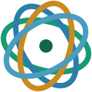

# Synerge Health Brand Guidelines

Version 1.0 · October 2026 · Owner: Synerge Health studio team

This document defines how Synerge Health looks, sounds, and behaves. It formalises the identity already in use on synergehealth.com and fills the gaps (logo rules, light-background use, voice, governance). Messaging lives in [MESSAGING.md](./MESSAGING.md). Assets live in [public/brand/](../public/brand) and are rebuilt with [build_brand_assets.py](./scripts/build_brand_assets.py).

---

## 1. Brand strategy

### Purpose
Help founders build healthtech around the needs of patients, care teams, and the markets they serve.

### Vision
Healthcare services that are more accessible, better connected, and designed around the needs of patients and care teams.

### Positioning
Synerge Health is a **healthtech venture studio for African markets**. We work *with* founders on product, operations, and company building. We are not a generic accelerator, and we do not treat African markets as one market.

### What makes the brand different
Context comes first. We start from the care workflow, the local payment, connectivity, and regulatory reality, and the people delivering care, then build the venture around it.

### Audiences
| Audience | They need to feel | What the brand must show |
|---|---|---|
| Founders | A hands-on partner who understands their market | Specific, practical support; scope agreed with each team |
| Investors | Discipline and clarity | Plain facts, structured approach, no hype |
| Health partners | Safety and respect for clinical reality | Rigour, careful language, accurate terminology |

### Values
1. **Context first.** Local workflows decide the product.
2. **Rigour.** Precise language, verified claims, evidence over enthusiasm.
3. **Collaboration.** We work alongside founders; scope is agreed together.
4. **Accountability.** We say what we do and do what we say.

### Brand promise (internal)
We state plainly what we do and what we have agreed. We make no promise about outcomes.

---

## 2. Brand architecture

| Level | Name | Rule |
|---|---|---|
| Master brand | **Synerge Health** | Always the full name in first use. "Synerge" alone is acceptable in running text after first mention. |
| Programmes and content | **Synerge Insights**, **Synerge Dispatch** | "Synerge" + descriptive noun. Use the same pattern for any new programme. |
| Portfolio ventures | *Decision needed* | Recommended: each venture keeps its own name and identity, with the endorsement line **"A Synerge Health venture"** in small type. |

Never write "Synerge Healthcare", "SynergeHealth" (except in the URL and email addresses), or "Synergy Health".

---

## 3. Logo

### The mark
Four interlocking orbits around a bright core. The orbits stand for the four parties in every venture: **Founder, Studio, Capital, Market**. The core stands for the **patient outcome** they exist to serve. The orbit colours are teal, blue, gold, and pale blue.

### The wordmark
SYNERGE HEALTH in Space Grotesk Bold, all caps, 0.05em tracking. "SYNERGE" is ink/white and "HEALTH" is teal (deep teal on light backgrounds).

### Files
All logo files are in [public/brand/](../public/brand) (served at `https://synergehealth.com/brand/…`). Text is outlined, so no font is needed.

| Use | File |
|---|---|
| Default, on dark backgrounds | `logo-primary.svg` / `logo-primary.png` (transparent, 2× for email) |
| On white or light backgrounds | `logo-primary-on-light.svg` |
| Narrow or square spaces | `logo-stacked.svg`, `logo-stacked-on-light.svg` |
| Mark only | `logo-icon.svg`, `logo-icon-on-light.svg`, `logo-icon.png` (512 px) |
| One-colour print, embossing, fax, stamps | `logo-mono-white.svg`, `logo-mono-black.svg`, `logo-icon-mono-white.svg`, `logo-icon-mono-black.svg` |
| Favicon and large display | `logo-icon-gradient.svg` (gradient rendering) |
| App icons | `apple-touch-icon.png`, `icon-192.png`, `icon-512.png`, `favicon-32.png` (in `public/`) |

### Clear space
Keep clear space equal to the height of the capital **H** in the wordmark on all four sides. For the mark alone, use one quarter of the mark's width.

### Minimum size
| Version | Screen | Print |
|---|---|---|
| Horizontal lockup | 120 px wide | 30 mm wide |
| Stacked lockup | 80 px wide | 22 mm wide |
| Mark alone | 16 px (use the gradient version) | 8 mm |

### Rendering rules
- Flat mark for interface and print. Gradient mark for favicon, large display, and social avatars on dark tiles only where the gradient stays visible.
- On backgrounds lighter than mid-grey, use the on-light or mono-black files. The pale orbits disappear on white.
- Use mono versions only where one colour is required.

### Do not
- Recolour the orbits or the wordmark outside the supplied palettes.
- Stretch, rotate, outline, add shadows or glows to, or re-typeset the logo.
- Put the dark-background logo on white, or the on-light logo on dark.
- Place the logo on busy photography without a solid or darkened panel.
- Separate "SYNERGE" and "HEALTH" onto different colours other than as supplied.
- Animate the orbits in a way that changes the shape of the mark.

---

## 4. Colour

The identity is a dark, clinical palette with a teal signature and a warm gold for action.

| Role | Name | Hex | Notes |
|---|---|---|---|
| Background | Void | `#060B09` | Default page background |
| Surface | Panel | `#0D1815` | Cards, alternate sections |
| Surface raised | Panel alt | `#111F1A` | Inputs, hover surfaces |
| **Signature** | Teal | `#2BE0B0` | Labels, links, active states, the core of the mark |
| Teal bright | Teal bright | `#5FF5CC` | Hover, focus ring, first orbit |
| Teal dim | Teal dim | `#1A9972` | Secondary accents, light-background orbit |
| Teal deep | Teal deep | `#12664D` | HEALTH on light backgrounds |
| **Action** | Gold | `#E3A83B` | Primary buttons only; third orbit |
| Gold light / dim | | `#F2C877` / `#A87522` | Illustration only |
| Information | Blue | `#3FA9E0` | Charts and diagrams |
| Sky / Sky light | | `#7FCBF2` / `#A9E4F5` | Orbits two and four |
| Text primary | Ink | `#F8FAFC` | Headings |
| Text body | | `#C2D1CB` | Body copy on dark |
| Text secondary | | `#A5B8B0` | Supporting text |
| Text muted | | `#8FA39A` | Captions, metadata (minimum text colour) |

These values are available as design tokens in [global.css](../src/styles/global.css).

### Proportion (guidance)
About 70% Void and Panel, 20% ink and neutral text, 8% teal, 2% gold. Gold appears once per view, on the primary action.

### Accessibility
Contrast ratios against the stated backgrounds (WCAG AA needs 4.5:1 for body text, 3:1 for large text and graphics):

| Foreground | Background | Ratio | Use |
|---|---|---|---|
| `#F8FAFC` | `#060B09` | 18.9 | All text |
| `#C2D1CB` | `#060B09` | 12.5 | Body |
| `#A5B8B0` | `#060B09` | 9.5 | Supporting text |
| `#8FA39A` | `#060B09` | 7.4 | Muted text |
| `#8FA39A` | `#0D1815` | 6.8 | Muted text on cards |
| `#2BE0B0` | `#060B09` | 11.7 | Labels, links |
| `#E3A83B` | `#060B09` | 9.4 | Gold on dark |
| `#060B09` | `#E3A83B` | 9.4 | Button text on gold |
| `#060B09` | `#2BE0B0` | 11.7 | Button text on teal |
| `#12664D` | `#FFFFFF` | 6.9 | HEALTH on white |
| `#0D1815` | `#FFFFFF` | 18.1 | Text on white |
| `#1A9972` | `#FFFFFF` | 3.6 | Graphics and large text only |

Do not use `#344A42` or darker greens for text; they fall below 3:1 on Void.

---

## 5. Typography

| Role | Font | Weight | Notes |
|---|---|---|---|
| Display and headings | **Space Grotesk** | 700 (bold), 600 for small headings | Self-hosted, no external requests. Variable 300–700 |
| Body | Arial / Helvetica system sans | 400 | Neutral, consistent on every device, no download |
| Labels, buttons, metadata | System monospace | 400–700 | Uppercase, wide tracking |

Space Grotesk is licensed under the SIL Open Font License (see `public/fonts/space-grotesk-OFL.txt`).

### Scale in use
| Element | Size | Style |
|---|---|---|
| Page title (H1) | `clamp(2.2rem, 5.5vw, 5.5rem)` | Bold, line height 1.06, tight tracking |
| Section title (H2) | 1.875–3rem | Bold, line height 1.1–1.25 |
| Card title (H3) | 1.125–1.5rem | Semibold, line height 1.35 |
| Body | 0.875–1rem | Line height 1.75–1.8 |
| Label | 0.72rem | Mono, uppercase, 0.18em tracking, teal |
| Button | 0.75rem | Mono, bold, uppercase, 0.1em tracking |

### Rules
- Sentence case for headings. All caps only for labels, buttons, and the wordmark.
- One H1 per page. Never skip heading levels.
- Maximum line length about 70 characters for body copy.
- Print and documents: Space Grotesk for headings, Arial for body. Do not introduce a third family.

---

## 6. Graphic language

| Element | Meaning | Use |
|---|---|---|
| **Vital line** (ECG trace) | Care and life signs | Hero and section dividers; stroke 1.5 px with a soft wide duplicate |
| **Orbit mark** | Founder, Studio, Capital, Market around the patient | Logo, large background watermark at low opacity |
| **Dot grid and fine grid** | Systems and structure | Backgrounds at 4–10% opacity |
| **Node diagram** | Connected care systems | Focus-area diagrams |
| **Corner brackets** | Precision | Card accents (short teal line at top-left) |

Shapes: cards 16 px radius, buttons fully rounded, 1 px borders at teal 8–15% opacity (35% on hover). Soft teal glows are allowed at low opacity; avoid heavy blur on mobile.

### Imagery
- Real people, real clinical and founder settings across African markets. Natural light, candid, dignified.
- No generic stock (stethoscope-on-laptop, handshake, glowing brain, lone doctor with tablet).
- Patients: obtain explicit consent; never imply a person is a patient, founder, or partner without written permission.
- Treat photography with a consistent dark teal grade; keep text on solid or darkened panels.
- Until an authentic library exists, use the graphic language above rather than placeholder photos.

### Iconography
Outline icons, 1.5–2 px stroke, rounded caps, drawn in ink or teal. Use the Lucide set already in the project.

### Motion
Restrained. Durations 150 ms (fast), 300 ms (base), 600 ms (slow). Ease `cubic-bezier(0.16, 1, 0.3, 1)`. Always honour reduced-motion settings. Motion must never be needed to understand content, and it must not slow the page down.

---

## 7. Interface components

| Component | Style |
|---|---|
| Primary button | Gold fill, Void text, mono bold uppercase, full radius |
| Secondary button | 1 px light border, body-colour text, teal on hover |
| Teal button | Teal fill, Void text (header and compact actions) |
| Link | Teal, brighter teal on hover |
| Focus | 2 px `#5FF5CC` outline, 3 px offset |
| Forms | No placeholder text; clear labels above fields; errors in plain language beside the field |
| Cards | Panel background, 1 px teal-tinted border |

Button labels: **APPLY AS A FOUNDER**, **INVESTOR ENQUIRIES**, **SUBMIT**, **SUBSCRIBE**. Verbs first, no punctuation.

---

## 8. Voice and writing

Short summary; full rules and examples are in [MESSAGING.md](./MESSAGING.md).

- **Clear:** plain words, short sentences, one idea each.
- **Calm and confident:** state facts. No hype, no exclamation marks.
- **Specific:** name the workflow, market, or step. Avoid abstractions.
- **Accountable:** say what we do and what is agreed. Make no promise about results, funding, or outcomes.
- **Respectful:** founders, clinicians, and patients are people, not "users" or "stakeholders".
- **Spelling:** British English (programme, enquiries, organisation, prioritise, specialised). Keep to one standard across site, documents, and email.
- **Terms:** *healthtech* (one word, lowercase), *venture studio*, *Africa's healthtech venture studio*, *founder*, *enquiry*.

---

## 9. Applying the brand

| Touchpoint | Standard |
|---|---|
| Website | Tokens in `global.css`; shared layout in `BaseLayout.astro`; fast on mobile is part of the brand |
| Social previews | `public/og-image.jpg` (1200×630), built from the template in the script |
| Browser and home screen | `favicon.svg`, `favicon-32.png`, `apple-touch-icon.png`, `site.webmanifest`, theme colour `#060B09` |
| Email | [email-base.html](./templates/email-base.html) and [email-signature.html](./templates/email-signature.html) |
| LinkedIn and X | [linkedin-banner.png](./exports/linkedin-banner.png), [x-header.png](./exports/x-header.png), [avatar.png](./exports/avatar.png) |
| Search | Organisation structured data in the page head, with the logo |

---

## 10. Governance

- **Owner:** the studio team; changes to the logo, colours, or voice need the owner's approval.
- **Single source:** tokens in `global.css`, assets in `public/brand/`, rebuild with the script. Do not edit generated files by hand.
- **Review:** audit the site against this document every quarter and before each major launch.
- **Pre-publish checklist:**
  1. Correct logo file for the background.
  2. Palette and contrast within this document.
  3. British spelling, approved terms, no outcome promises.
  4. No placeholder text in forms or copy.
  5. Every claim can be verified; every image has consent and credit.
  6. Alt text on informative images; headings in order.

---

## 11. Open decisions

These need an owner decision or external input, and are not assumed in this document:

1. **Trademark.** Search and register the name and mark in the target classes and markets.
2. **Portfolio endorsement line.** Confirm "A Synerge Health venture" or choose another.
3. **Photography.** Commission or collect an authentic image library with consent and usage rights.
4. **Instagram.** The footer no longer shows an Instagram icon because no account is linked. Add it back when an account exists.
5. **Brand email domain.** Confirm the sending address and SPF/DKIM/DMARC before customer-facing email goes out.
6. **Documents.** Pitch deck, investor one-pager, and founder guide need approved content before layout; the logo, colours, and type here apply directly.
7. **Light theme.** The site is dark only. A light theme needs design work; the on-light logo and deep teal exist for that day.

---

## 12. Critical site and brand review (16 October 2026)

This is a record of a candid review of the live site, not a declaration that every observation is a verified business fact. The review sampled the home, portfolio, founders, investors, services, events, careers, contact, and About pages. Mobile screenshots were inspected at 390 × 844. The desktop screenshot tool unexpectedly returned a narrow viewport, so desktop visual composition was not fully assessed. Recheck live conditions before acting on time-sensitive observations.

### Overall assessment

The site is fast, technically tidy, accessible in several important ways, and cautious about unsupported promises. Its central weakness is trust: it asks founders and investors to take Synerge Health seriously without showing enough about the people, work, track record, or local presence behind the studio. The visual identity is coherent but currently resembles a generic dark technology brand more than a distinctive healthcare venture studio.

### Observations

#### Proof and credibility

- The sampled pages showed no rendered photos or other `` content in their main page content. The identity therefore has no human or place-based evidence of its African-market positioning.
- No team names, biographies, location, or direct contact details were visible in the sampled pages. Confirm what the organisation is willing and able to publish before treating this as a content omission.
- The portfolio page says company names are not published and presents one anonymised pharmacy-management example without measurable outcomes. That may be appropriate for confidentiality, but it gives a prospective founder or investor little evidence to evaluate.
- The four sampled Insights articles were labelled “Editorial Team” and shared the same publication date. Verify whether that reflects actual authorship and publication history; if so, provide named authors, sources, and a publishing cadence that reflects real editorial work.
- No named partners, attributable case studies, or quantified results appeared in the sampled routes. Do not add metrics or endorsements without substantiation and permission.

#### Message and positioning

- The home headline, “Building Africa’s next generation of healthtech,” is broad and uses a familiar “next generation” claim. It does not explain what Synerge does differently.
- The site speaks to African markets broadly, while its visible article topics focus on Nigeria and some programme copy refers to Sub-Saharan Africa. Choose a geographic claim that matches current activity and evidence; do not present Africa as one uniform market.
- Phrases such as “explore healthcare needs,” “Strategic Guidance,” and “Operational Support” are safe but generic. Replace abstraction with specific activities, the stage of venture supported, and concrete examples where approved.
- Some qualification-heavy copy (for example, “where a venture and agreed scope are a fit”) may sound defensive. Keep the necessary limits, but say them plainly and confidently.
- Confirm the investor-page statement that Synerge invests in ventures, including whether it accurately describes the current model and any relevant regulatory position.

#### Information architecture and naming

- The same service pillars are described as “Studio collaboration areas,” “Studio partnership areas,” and “Areas of studio support.” Use one name consistently.
- The founder offer is called “Founder Studio Programme,” “Founder Programme,” and “Venture Studio Model.” Decide whether this is a programme, a studio model, or both; distinguish the terms only if they describe genuinely different things.
- About, Services, Founders, and Portfolio contain overlapping explanations. Map the reader journeys and consolidate repeated material without removing information needed by distinct audiences.
- Events says that no events are listed; Careers invites expressions of interest with little supporting information. If these offerings are not active, consider removing them from primary navigation/footer or making them noindex until useful content exists.
- The Portfolio page combines portfolio information with founder and investor calls to action. Separate those journeys and avoid implying a portfolio depth the page cannot substantiate.

#### Visual identity

- The near-black backgrounds, bright teal accents, network graphics, and mono labels create a polished technology aesthetic, but also risk blending into a large category of dark-mode AI and crypto brands.
- The current visual system does little to express specific African places, clinical settings, or people. Gold alone is not a meaningful regional identity. Build any geographic visual language from commissioned or licensed references and avoid pan-African motifs that flatten distinct cultures.
- The orbit mark can read as a generic atom or science symbol. Its intended meaning is not self-evident, and the “Founder, Studio, Capital, Market” interpretation in the code has not been validated with the brand owner or audiences. At favicon size, the intersecting lines become difficult to distinguish.
- The header uses a flat orbit mark while small app/browser assets use a gradient rendering. Keep one canonical mark and define any small-size simplification as a deliberate responsive variant.
- The wordmark uses a typeface without a distinctive custom feature. This is usable, but offers limited ownability by itself.
- Wide-tracked mono uppercase appears across many labels and controls. Preserve it for small metadata and selected labels; reduce it where repeated use harms reading comfort or creates a developer-tool impression.
- Arial was selected as a system-font fallback to avoid extra network requests. It is a performance choice rather than a distinctive brand asset; evaluate a self-hosted body face only if measured performance remains acceptable.
- The homepage contains numerous pieces of text below 12 px. Raise essential labels and metadata where feasible, and check actual rendered contrast and legibility rather than relying on colour ratios alone.
- The design guide’s “gold once per view” guidance and sentence-case recommendation are not consistently followed by the current UI. Either revise the rule to match a deliberate design decision or bring the UI into line.

#### Mobile layout and experience

- The mobile home hero leaves a large empty area after the calls to action, without proof or a clear cue to continue. Reassess hero height and vertical spacing at common phone sizes.
- The two hero calls to action have different widths and appear centred beneath left-aligned content. Align their placement and hierarchy deliberately.
- The ECG line is a small decorative accent rather than a distinctive, legible brand device. Either give it a purposeful role or reduce its prominence.
- The founder and investor paths lead to forms but do not clearly explain what happens after submission, who responds, or when. Add only a response commitment the team can reliably meet.
- Mobile screenshots are not a substitute for desktop browser validation; retest both layouts in a normal desktop viewport.

### Recommended order of work

1. **Establish proof and ownership.** Confirm the team’s approved public biographies, location, actual venture activity, named work, partner permissions, and any publishable outcomes. If these cannot be shared, explain the confidentiality boundary and give a useful description of the studio’s process.
2. **Sharpen positioning.** Replace the broad home promise with a concrete, evidence-backed description of the geography, venture stage, and work Synerge actually supports. Remove “next generation” unless there is a specific reason to retain it.
3. **Choose a consistent geographic scope.** Align the headline, FAQ, programme criteria, investor copy, and editorial topics with current activity.
4. **Rationalise the navigation and names.** Give each offer one name, consolidate repeated page content, and decide whether thin Events and Careers pages belong in the main navigation.
5. **Improve editorial credibility.** Verify article bylines and dates, add named authors and sources where possible, and publish at a cadence the team can sustain.
6. **Test the identity with actual audiences.** Ask founders, investors, and healthcare partners what the mark, palette, and language communicate before commissioning a redesign. Specifically test whether people see care and venture building, or only generic technology/science.
7. **Refine visual expression.** Develop an approved image library with consent and rights; test a warmer reading surface or light editorial treatment; reduce unnecessary mono labels; define one mark system with a legible small-size variant.
8. **Run legal and operational checks.** Conduct a professional trademark search for “Synerge Health” and the mark in intended markets before further investment. Verify the investment claim and approved portfolio endorsement separately.
9. **Validate the experience.** Conduct desktop and mobile usability sessions with real prospective founders and investors; measure task completion and form completion, not just visual preference.

### Decisions and evidence required

Do not resolve these by inventing facts:

- Who is approved to be named and photographed, and what location can be published?
- Which country or countries are currently active, and what supports the broader African-market statement?
- What portfolio work, results, or partnerships may be shared, and what must remain confidential?
- Is Synerge Health currently investing directly, and how should that be described?
- What response timeframe can the team consistently honour after applications and enquiries?
- Is “Founder Programme” an active formal programme, or should the site describe founder collaboration without implying a cohort or programme structure?
- Has the name and mark been professionally searched for conflicts?

### Review status

This section records the critique and proposed work for later use. It does **not** assert that the recommendations have been completed, audience-tested, legally cleared, or approved by the brand owner.
